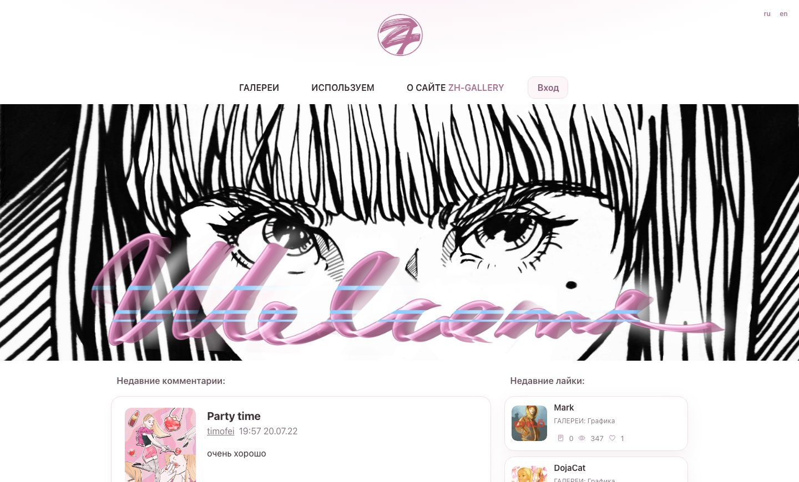
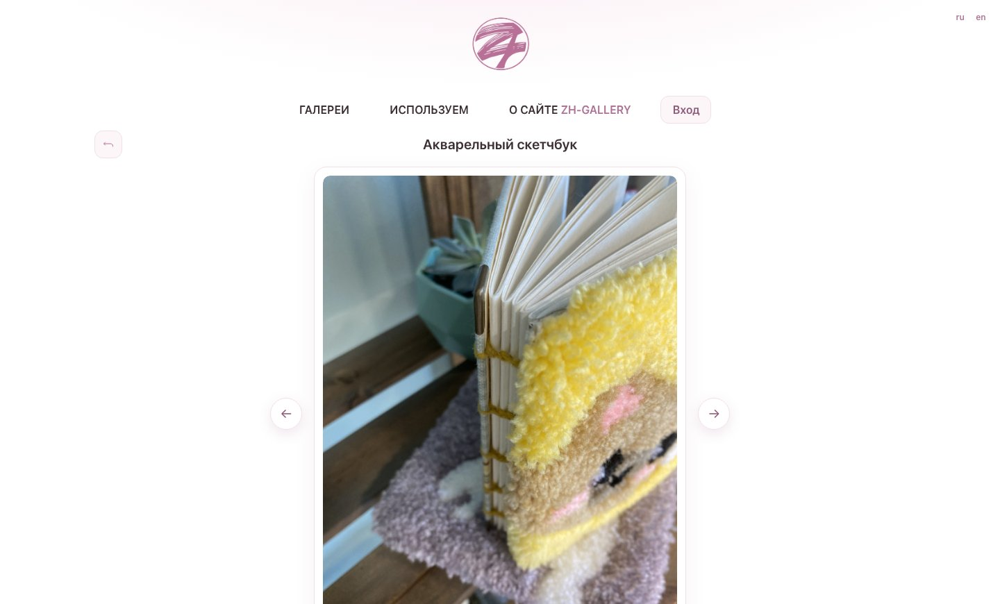

# zh-gallery

[](https://github.com/voltov-tom/zh-gallery/actions/workflows/ci.yml)
[](https://github.com/voltov-tom/zh-gallery/actions/workflows/deploy.yml)


Галерея работ творческого человека: [zh-gallery.ru](https://zh-gallery.ru).
Категории → подкатегории → работы, лайки и комментарии, личный кабинет,
двуязычный интерфейс (ru/en), вход через ВКонтакте и Mail.ru,
JSON API для Telegram-бота.





## Что умеет

* **Каталог** — категории и подкатегории с обложками, карточки работ, счётчики
  просмотров и лайков, sitemap для поисковиков.
* **Просмотр работы** — большая картинка с зумом, перелистывание стрелками и
  свайпами, лента комментариев, лайк в один клик.
* **Личный кабинет** — свои комментарии (редактирование и удаление без перезагрузки),
  лайкнутые работы, смена пароля и адресов почты.
* **Медиа** — файлы хранятся в Nextcloud по WebDAV и не лежат в репозитории; сайт
  отдаёт уменьшенные копии с локальным кэшем и оригинал для зума.
* **Админка** — превью категории из существующих работ, кнопка генерации описания
  через vision-модель, миниатюры в форме.
* **Юридические страницы** — политика обработки персональных данных и условия
  использования на двух языках, запись факта согласия при регистрации.
* **Аналитика** — Яндекс Метрика, счётчик подключается только после согласия
  в cookie-уведомлении.

## Скелет проекта

```
zh_gallery/
├── core/                  # галерея
│   ├── models.py          # категории, подкатегории, работы, лайки, отзывы
│   ├── selectors.py       # чтение из БД (вьюхи не знают про ORM)
│   ├── services.py        # запись: лайки, отзывы, просмотры
│   ├── views/             # страницы каталога, работы, юридических документов
│   ├── api/               # JSON API: лайки, отзывы, эндпоинты для бота
│   ├── integrations/      # Nextcloud WebDAV, vision-модель для описаний
│   ├── imaging.py         # приведение картинок к веб-размеру (Pillow, EXIF)
│   ├── media_cache.py     # локальный кэш медиа на случай недоступности Nextcloud
│   ├── management/        # команды: демо-данные, кэш медиа, проверка файлов
│   ├── templates/         # шаблоны галереи
│   └── static/            # CSS, ES-модули, вендорные Bulma и иконки
├── userprofile/           # личный кабинет, формы входа и регистрации
├── zh_gallery/            # настройки (local/production/test), urls, wsgi
├── templates/             # переопределения шаблонов писем и allauth
├── locale/                # переводы ru/en
└── deploy/                # конфигурация запуска: compose, nginx, служебные скрипты
```

## Стек

| Слой | Технологии |
|------|------------|
| Бэкенд | Python 3.12, Django 5.2 LTS |
| Аутентификация | django-allauth (локальные аккаунты, ВКонтакте, Mail.ru) |
| БД | PostgreSQL 16, в тестах — SQLite в памяти |
| Кэш и сессии | Redis через django-redis, без Redis работает на БД |
| Медиа | Nextcloud WebDAV (свой клиент) с локальным кэшем |
| Фронтенд | Django-шаблоны, Bulma и иконки локально, нативные ES-модули |
| Качество | pytest, ruff, GitHub Actions, pip-audit |

## Качество

* 238 pytest-тестов, включая проверки безопасности, запросов к БД и отдачи медиа;
* `ruff` для линта и форматирования, `makemigrations --check` в CI;
* GitHub Actions: тесты на Python 3.12 и 3.13, аудит зависимостей, деплой после
  зелёного CI.

## Документация

* [CHANGELOG.md](CHANGELOG.md) — версии и история исправлений;
* [.env.example](.env.example) — все переменные окружения с комментариями;
* [LICENSE](LICENSE) — MIT.
